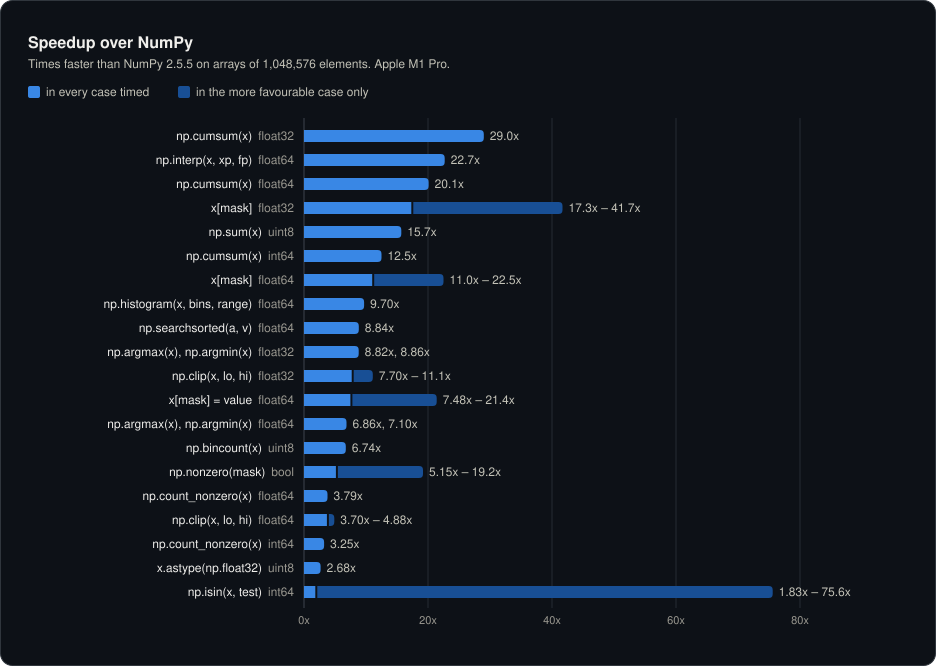

# hotkernels

Fast kernels for the NumPy operations where NumPy is slow, delivered as a zero-friction drop-in: hand-written assembly where it can actually win, plain C where the compiler is already enough.

Kernels are written by coding agents iterating against a judge. The judge checks every kernel against NumPy and times it against NumPy and naive `clang -O3` C.

**On an Apple M1 Pro, all 22 kernels are faster than NumPy at every size measured. At a million elements, 17 of them are more than 5x faster and the best is 76x. Twenty return NumPy's result bit for bit.**

## Results

How many times faster each kernel is than NumPy, and than the same loop written in plain C and compiled with `clang -O3`:



| NumPy call | Elements | vs NumPy | vs `clang -O3` |
|---|---|---|---|
| `np.cumsum(x)` | float32 | 29.0x | 7.83x |
| `np.interp(x, xp, fp)` | float64 | 22.7x | 6.02x |
| `np.cumsum(x)` | float64 | 20.1x | 5.48x |
| `x[mask]` | float32 | 17.3x – 41.7x | 2.70x – 5.70x |
| `np.sum(x)` | uint8 | 15.7x | 5.07x |
| `np.cumsum(x)` | int64 | 12.5x | 1.95x |
| `x[mask]` | float64 | 11.0x – 22.5x | 1.67x – 4.10x |
| `np.histogram(x, bins, range)` | float64 | 9.70x | 3.59x |
| `np.searchsorted(a, v)` | float64 | 8.84x | 8.42x |
| `np.argmax(x)`, `np.argmin(x)` | float32 | 8.82x, 8.86x | 26.6x, 26.7x |
| `np.clip(x, lo, hi)` | float32 | 7.70x – 11.1x | 1.00x – 1.44x |
| `x[mask] = value` | float64 | 7.48x – 21.4x | 4.64x – 19.0x |
| `np.argmax(x)`, `np.argmin(x)` | float64 | 6.86x, 7.10x | 12.7x, 13.2x |
| `np.bincount(x)` | uint8 | 6.74x | 1.31x |
| `np.nonzero(mask)` | bool | 5.15x – 19.2x | 2.47x – 8.08x |
| `np.count_nonzero(x)` | float64 | 3.79x | 1.28x |
| `np.clip(x, lo, hi)` | float64 | 3.70x – 4.88x | 1.01x – 1.30x |
| `np.count_nonzero(x)` | int64 | 3.25x | 1.03x |
| `x.astype(np.float32)` | uint8 | 2.68x | ships as the C |
| `np.isin(x, test)` | int64 | 1.83x – 75.6x | 1.00x – 5.34x |

Apple M1 Pro, NumPy 2.5.5, Apple clang 21, arrays of 1,048,576 elements, where the fixed cost of a call no longer matters. A range covers the two cases the kernel is timed in: 5% and 50% of the elements selected for the mask kernels, test values close together or far apart for `isin`, and, for `clip`, bounds of (-0.5, 0.5) at the high end and bounds of (0, 1) on data that holds negative zeros at the low end. Results at every size from 16 to 16,777,216 elements, with confidence intervals, are in [docs/kernel-findings.md](docs/kernel-findings.md).

What stands behind the numbers:

- **Checked against NumPy, not against a description of it.** Every kernel is compared with NumPy's own output on inputs that include NaN, infinities, signed zeros, ties and denormals. Twenty of the 22 match bit for bit. The two float `cumsum` kernels regroup the additions, which is where their speed comes from, and stay within a declared error bound.
- **Memory-safe by test.** Each kernel runs with its buffers placed against inaccessible pages, so reading or writing one byte outside them crashes the check.
- **Assembly only where it wins.** A kernel keeps its assembly only if the judge finds it significantly faster than the compiled C. `astype` from `uint8` to `float32` did not pass that bar and ships as C.

What the numbers do not say:

- **The kernels are not callable from Python yet.** They are timed as native functions; the NumPy figure is NumPy called the usual way.
- **Two results depend on the arguments.** `np.isin` is fast when the test values all lie between 0 and 65,534 or within 32,767 of the first one, and ties the C otherwise. `np.clip` with a lower bound of zero, as in `np.clip(x, 0, 1)`, is about 1.3x over the C in cache when the data holds no negative zeros and runs at the speed of the C when one occurs in the first few thousand elements; with an upper bound of `-0.0` it always runs at the speed of the C. Those cases are timed, and are the low ends of those rows.
- **Scalar arguments are verified for the values each spec lists.** `np.clip` is checked with twelve pairs of bounds and `np.histogram` with sixteen bin counts and ranges, not with every possible one.
- **One machine.** Every figure is from a single Apple M1 Pro.

## What is here

- **The judge** (`judge/`): checks a kernel for correctness and memory safety, and reports how fast it is.
- **Fixture kernels** (`judge/fixtures/`): `argmax_f32`, `compress_f32`, `compress_scratch_f32` and `tally_u8`, used to test the judge itself.
- **The survey** (`survey/`): measures NumPy against naive C per operation, to decide which kernels are worth writing. Recorded results are in `survey/results/`.
- **Kernels** (`kernels/`): 22 kernels for 15 NumPy operations, each with a spec, a naive C reference and, where assembly beats the C, an ARM64 version. They are checked and timed by the judge but not yet installable. Each kernel's `attempts.md` lists every optimisation tried, kept or not.

Supported platform: macOS on Apple Silicon (ARM64).

## Using the judge

Requires the Xcode command line tools and [uv](https://docs.astral.sh/uv/).

```bash
uv run judge selftest            # prove the judge catches known-bad kernels
uv run judge check argmax_f32    # lint and correctness for one kernel
uv run judge run argmax_f32      # correctness, then a timing report
```

## Using the survey

```bash
uv run survey run                 # measure every candidate; takes about 15 minutes
uv run survey run --only argmax   # measure the candidates whose name matches
uv run survey report survey/results/apple-m1-pro.json   # regenerate a report
```

## Documentation

- [docs/core-design.md](docs/core-design.md): what the project is building and why
- [docs/judge-design.md](docs/judge-design.md): how kernels are checked and timed
- [docs/survey-design.md](docs/survey-design.md): where NumPy is slow, and which kernels to build in what order
- [docs/kernel-findings.md](docs/kernel-findings.md): what each kernel achieves, how, and where assembly could not win
- [docs/delivery-design.md](docs/delivery-design.md): how the kernels are to reach unmodified NumPy code: the binding, `install()` and `report()`
- [AGENTS.md](AGENTS.md): rules for coding agents working in this repository
- [kernels/README.md](kernels/README.md): how to add a kernel

## Licence

MIT
